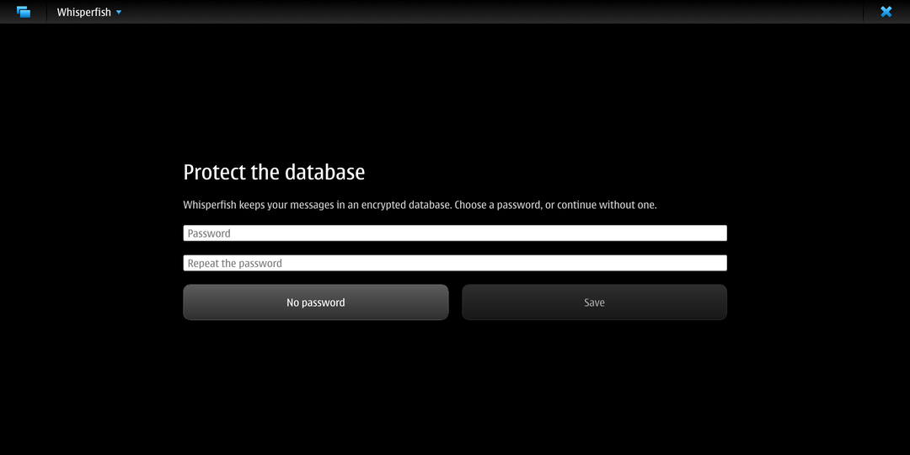
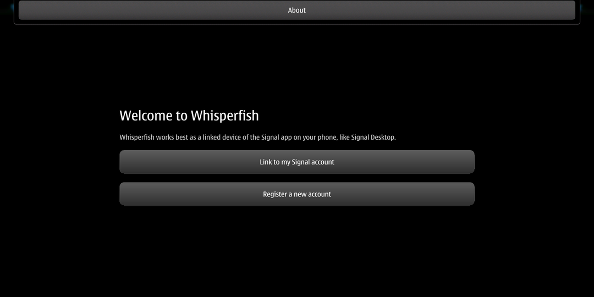
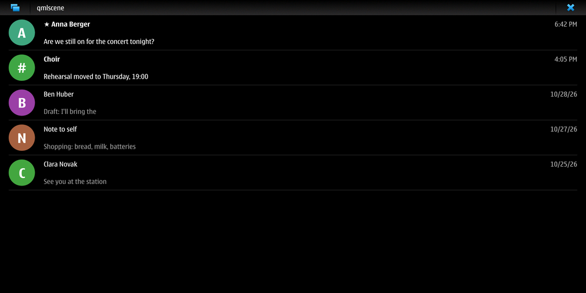
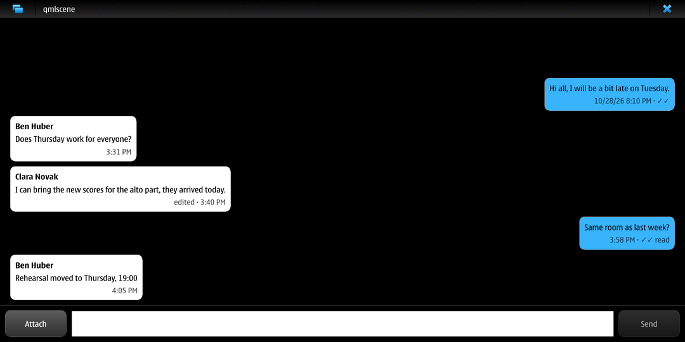

# Whisperfish for Maemo Leste

This is a port of [Whisperfish](https://gitlab.com/whisperfish/whisperfish),
the unofficial [Signal](https://signal.org) client for Sailfish OS, to
[Maemo Leste](https://maemo-leste.github.io/), with a Hildon (Maemo 5)
user interface. It was made for the F(x)tec Pro1X, but it should run on
any arm64 Leste device.

All the Signal work is done by Whisperfish's Rust backend (libsignal,
the message store and the actors), unchanged from upstream. The port
replaces only the Sailfish parts:

- **User interface.** The Sailfish Silica QML is replaced by a smaller UI
  in `leste/qml`, built on QtQuick.Controls 1, so that Leste's Maemo 5
  Qt style draws the controls. Every page is a `QMainWindow` with a
  `QQuickWidget` (`whisperfish/src/leste.rs`). With Leste's Qt platform
  plugin, the main window's menu bar becomes the Hildon application menu,
  conversations open as stacked windows with the back arrow, and the
  title bar shows the progress indicator while Whisperfish is busy.
- **Application shell.** Instead of libsailfishapp there is a plain
  `QApplication` (the `leste` cargo feature in `whisperfish/src/platform.rs`).
- **Notifications.** New messages are shown through hildon-home
  (`org.freedesktop.Notifications`).
- **No Sailfish services.** No journald (Whisperfish logs to stdout),
  no Sailfish Secrets (upstream doesn't use it either: the database is
  sqlcipher with an optional password), and no sailfish-qml captcha
  helper (the captcha page opens in the browser).

The upstream README is in [README-upstream.md](README-upstream.md).

## What works

This is a first, **pre-release** version. "Tested on the device" below
means: on the Pro1X, with the package installed in a chroot of a Leste
image, and hildon-desktop and Whisperfish on a virtual screen (Xvfb) with
the session environment of the phone (`leste/test/chroot-test.sh`). It
has not run on the phone's own display yet, and nobody has linked a real
Signal account to it yet.

| Feature | Status |
|---|---|
| Linking as a secondary device (QR code to scan with the Signal app) | The QR code comes from Signal's server and is shown (tested on the device). Finishing a link with a real phone is **not tested yet** |
| Database with or without a password | Tested on the device up to linking |
| Unlocking an existing database with its password | Implemented, not tested |
| Registering a new main account (phone number, captcha, code) | Implemented, not tested |
| Conversation list (contacts, groups, note to self, drafts, unread) | Implemented; the layout is tested on the device with made-up data |
| Reading and sending text messages, in groups too | Implemented; the layout is tested with made-up data, not tested with an account |
| Attachments: sending (file dialog), showing images, downloading and opening files | Implemented, not tested |
| Read receipts (sent and shown), delivery ticks, edited marks | Implemented, not tested |
| New conversation by Signal username | Implemented, not tested (no phone number lookup) |
| Notifications of new messages through hildon-home (respects the privacy setting) | Implemented, not tested |
| Settings: what notifications show, Return to send | Implemented, tested on the PC |
| Hildon application menu (tap on the title bar) | Tested on the device |
| Stacked windows with the back arrow (conversation, settings, about) | **Not working yet in the device test**: the About window opened without the back arrow, and its content did not show. A fix, which makes the main window the bottom of the stack, is in but not tested yet |
| Title bar progress indicator while busy | Implemented, not checked |
| Calls, voice notes, reactions, replies/quotes, stickers, stories, address book, background service, the other settings | Not ported |

Closing the main window quits Whisperfish. There is no background mode
yet, so messages arrive only while the app is open (Signal keeps them for
you meanwhile).

## Screenshots

On the Pro1X's Hildon (in the test chroot, see above). The last two show
the QML with made-up data, as qmlscene shows it.

| | |
|---|---|
|  |  |
|  |  |

## Install

Download `whisperfish-leste_*_arm64.deb` from the
[releases](https://github.com/smatkovi/whisperfish-leste/releases) and,
as root on the device:

    apt install ./whisperfish-leste_0.6.0~dev-1_arm64.deb

Whisperfish then shows up in the application menu. On first start it
asks for a database password (or none). Choose "Link to my Signal
account", then in the Signal app on your phone go to *Settings → Linked
devices → Link new device* and scan the code. The device is called
"Whisperfish (Maemo Leste)".

The data lives where it does on Sailfish OS:
`~/.config/be.rubdos/harbour-whisperfish` and
`~/.local/share/be.rubdos/harbour-whisperfish`.

## Building

The package is cross-compiled on an x86_64 PC against a Debian bookworm
arm64 sysroot. Maemo Leste daedalus is built on Debian bookworm, with the
same glibc 2.36 and Qt 5.15.8. You need Rust with the
`aarch64-unknown-linux-gnu` target, clang, lld, llvm-ar, cmake, perl,
make and protoc. You also need debootstrap and qemu-user binfmt to create
the sysroot.

    sudo leste/cross/make-sysroot.sh /path/to/sysroot
    LESTE_SYSROOT=/path/to/sysroot leste/build-deb.sh

`leste/cross/env.sh` sets up clang/lld, the qmake stand-in that the Qt
build scripts query, and pkg-config/CMake for the sysroot. The result is
`leste/out/whisperfish-leste_<version>_arm64.deb`. The build uses
`--features leste` (bundled sqlcipher and OpenSSL, no calling).

## Testing without touching the device's system

- `leste/test/chroot-test.sh` runs on the device as root. It installs the
  package in a chroot of an overlay on a Leste image (read-only lower
  layer), starts hildon-desktop and Whisperfish on Xvfb with the
  device's session environment, and takes screenshots after scripted
  clicks.
- `leste/test/qemu-preview.sh` runs on the PC. It renders the QML with
  made-up data (`leste/test/preview`, a QML stand-in for the Rust types)
  in the arm64 sysroot under qemu-user.

## License and credits

Whisperfish is © Ruben De Smet and the Whisperfish contributors, licensed
under the GNU AGPL v3 (see [LICENSE](LICENSE)). The Maemo Leste port
(the `leste` directory, `whisperfish/src/leste.rs` and the `leste`
platform) is under the same license. Signal is a trademark of Signal
Messenger, LLC; this project is not affiliated with Signal or with the
Whisperfish project.
